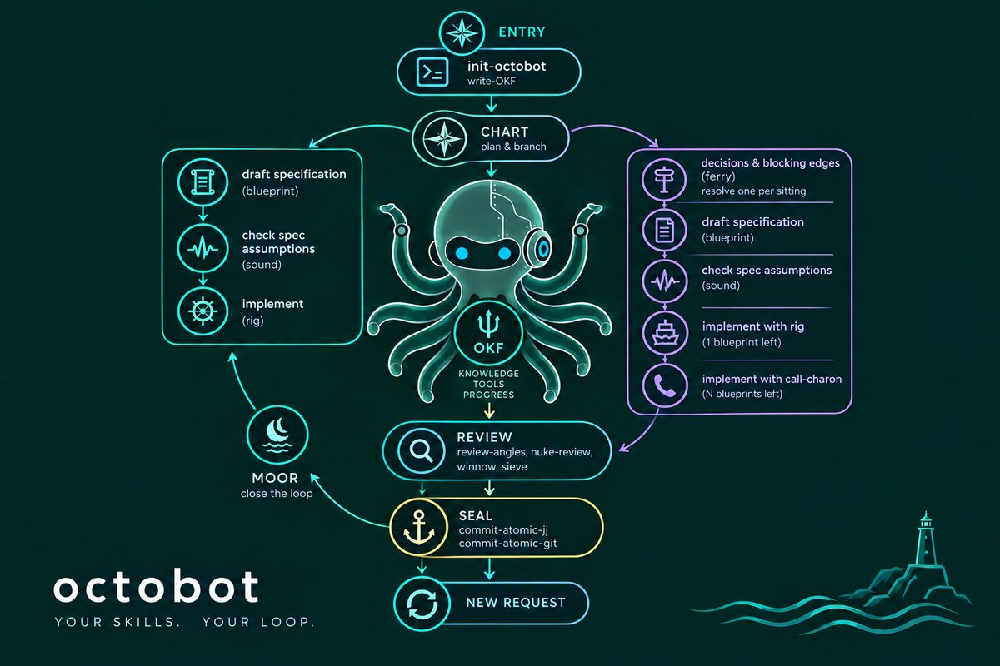

# octobot

<table>
<tr>
<td width="60%" align="center">
  
  <h3>octobot</h3>
  <p>Personal, reusable skills for long term projects - productivity workflows that travel with you across every project.</p>
</td>
<td width="60%">

## Table of Contents
- [Why this exists](#why-this-exists)
- [Inspiration](#inspiration)
- [Authorship & testing](#authorship--testing)
- [Install](#install)
- [Skills](#skills)
- [Workflows](#workflows)
- [Adding a skill](#adding-a-skill)
- [Roadmap](#roadmap)
- [License](#license)

</td>
</tr>
</table>

## Why this exists

[mattpocock/skills](https://github.com/mattpocock/skills) works perfectly
for lean, coding tasks. Octobot grew out of adapting that set with my own
experiences with analytical workflows carrying vast biological context —
reporter assays, single cell and bulk RNA-seq, genomics or clinical
pipelines. If you add the time needed to generate a hypothesis, run wet
lab experiments, the periods of time are getting very long. As a
computational biologist you also are involved in multiple parallel
projects. Bioinformatics analysis usually requires deep project
understanding and tremendous focus. This situation creates a specific
knowledge and mental gap that has to be removed quickly. This can be done
in many ways. My preferred way is to write decisions and their
justifications in human readable format and to keep a functional, project
directory structure supported by version control. This is the reason why
I made a conscious decision to extend documentation and bake it into the
loop itself (the OKF wiki, blueprints, decision files) rather than leave
it implicit, plus a Socratic front end (`grill-me`, `chart`, `sound`) and
backend (`winnow`, `nuke-review`, `sieve`, `review-angles`), to pin down
ambiguity before it becomes an expensive rewrite three months later.
Initially, I developed my own skill workflow that turned out to be very
similar to other skill repositories that got significant traction on
GitHub. Therefore, I decided to merge my workflow with current best
practices.

## Inspiration

- [Matt Pocock's skills](https://github.com/mattpocock/skills) — the base
  this repo is modeled on.
- [Superpowers](https://github.com/obra/superpowers)
- [Ponytail](https://github.com/DietrichGebert/ponytail) — highly
  recommended paired with octobot's skills when writing code.
- [Andrej Karpathy's skills wiki](https://gist.github.com/karpathy/442a6bf555914893e9891c11519de94f)
  (also mirrored as
  [andrej-karpathy-skills](https://github.com/multica-ai/andrej-karpathy-skills/blob/main/CLAUDE.md),
  itself the source of `CLAUDE.md` §1–4 here)
- [Google's Open Knowledge Format](https://cloud.google.com/blog/products/data-analytics/how-the-open-knowledge-format-can-improve-data-sharing/) —
  the shape behind octobot's `OKF/` wiki.

## Authorship & testing

Initial drafts of these skills were human-written and came from my own workflow.
I backed them on top of Matt Pocock's skills. During development I adapted them
with Anthropic's Sonnet and Opus models as well as Qwen's. Skills were tested
across multiple harnesses: Claude Code, GitHub Copilot, and the Pi coding
agent.

## Install

**Claude Code, or any Agent Skills-compatible harness on this machine.**
Claude Code discovers skills at `~/.claude/skills/<name>/SKILL.md` (flat,
one level deep — category subfolders are not scanned); Codex and similar
harnesses read `~/.agents/skills/<name>/`. Clone this repo, then run:

```bash
scripts/link-skills.sh
```

It symlinks every skill into both directories, so a `git pull` (or `jj
git fetch`) is all that's needed to keep them up to date. Open any
project, start your agent, and the skills below appear in the skill
list. Optionally, run `/talk-caveman` for terse mode — no preamble, no
summaries — it overlays any workflow below.

**Any other harness** (Copilot, or anywhere `~/.claude/skills` doesn't
apply): `npx skills@latest add lukabor/octobot` copies the skills you
pick into your project as ordinary files.

## Skills

### loop — the metaharness spine
Octobot's core: a loop-engineering metaharness over an **OKF**
(open-knowledge-format) wiki at each project's `./OKF/`. First time in a
repo? Run `/init-octobot` before any of this — it bootstraps `AGENTS.md`
and a bare `OKF/` so the spine below has something to scaffold or refresh.

<p align="center">
  
  <br/>
  <sub>Generated with GPT-5.6 Luna</sub>
</p>

- **write-OKF** — scaffold or refresh the OKF wiki; wires `AGENTS.md` so
  every agent reads `OKF/index.md` before code.
- **chart** — plan a project or revise its plan (`OKF/ROADMAP.md`);
  greenfield and revision modes (replaces plan-project + update-project).
- **blueprint** — synthesize discussed work into a justified, verifiable
  blueprint at `OKF/blueprints/NNN-<slug>.md` (status: draft → locked → implemented).
- **sound** — verified recon before a lock: OKF, then the nostos MCP
  server, then files only where nostos cannot answer; stamps `sounded:`.
- **ferry** — work too big for one session becomes a directory of small,
  edge-declared decision files; resolve one per sitting.
- **rig** — execute one locked blueprint: bdd at its seams, four-axis
  review, run its Verify with pasted output, seal citing the blueprint.
- **call-charon** — deliver an arrived ferry's blueprints via agents:
  one isolated builder per blueprint, fresh-context review flotilla,
  orchestrator-run Verify gate, passage logged in `MAP.md`.
- **moor** — close out a delivered ferry: reconcile the wiki with what
  shipped, extract loose ends into new blueprints/ferries, shrink
  index.md; status flips, nothing deleted.
- **steer** — router over every skill; most are user-invoked, steer is
  the index.

Every loop skill is user-invoked (`disable-model-invocation: true`)
except **sound**, which only reads — see `OKF/decisions/019`.

### productivity
- **conjure-a-skill** — meta-skill that scaffolds new skills consistently.
- **write-handoff** — produce a structured handoff doc for a fresh session.
- **grill-me** — Socratic loop to remove ambiguity before implementing.
- **resolve-conflicts-jj** — jj conflict discipline: topology first, both
  intents preserved, headless-safe squash.
- **talk-caveman** — terse-mode: no preamble, no summaries, code + one-line why.
- **spawn-cavecrew** — how to invoke the plugin `caveman:cavecrew-*` agents
  (investigator / builder / reviewer) without the agent-type error; octobot
  defaults (`jj diff` review, `commit-atomic-jj` commit).
- **commit-atomic-jj** — atomic-commit discipline: `jj diff` → split → semantic
  message; docs / docstrings / READMEs ship in the same change. Message
  structure (1-3 blank-line-separated blocks, `type(scope): phrase[;
  starts|extends|ends REF]`) is checked by `scripts/commit-msg-check` —
  mandatory pre-`jj describe` step (jj has no hook mechanism), or a real
  `git commit-msg` hook via `--install-hook` in plain git repos. Works in
  any repo, not just octobot — resolve the script from this skill's own
  base directory, not the target repo's cwd. Extend the closed `type`
  set per repo with an optional `.commit-lint.toml` (`extra_types =
  [...]`) at that repo's root; no file needed for the default set.

### engineering
- **sieve** — Socratic Real / Good / Minimal gate; burden on *keeping*, not
  cutting. Fires at the seal boundary (build, prune, analysis). Pairs with
  `winnow`.
- **winnow** — blunt after-the-fact debloat audit; `delete/stdlib/native/
  yagni/shrink` tags, `net: -N lines`. Only ever removes. Pairs with `sieve`.
- **harden-background-work** — rules for daemon threads, trigger loops, shared
  locks, readiness surfaces — the failures a green unit suite misses.
- **review-angles** — recall-biased correctness checklist for the post-green
  review pass (stale refs, TOCTOU, ordering state, durability, invalidation).
- **review-blueprint** — the blueprint-fidelity axis: diff vs `OKF/blueprints/NNN` —
  complete, contained, verified (output pasted). rig's done-gate.
- **nuke-review** — exceptionally strict structural-quality review for code
  judo moves; ported from cursor/plugins thermo-nuclear-code-quality-review.
  Pairs with `review-angles` (correctness) and `winnow` (debloat) as the
  three post-green review axes. User-invoked.
- **bdd** — strict red-green-refactor loop with BDD Given/When/Then
  scenarios as the unit of work.
- **diagnose** — six-phase bug hunt: feedback loop → reproduce →
  hypothesise → instrument → fix with regression test → cleanup.
- **grill-with-docs** — user-invoked router that runs `grill-me` using
  `model-domain` on an existing codebase.
- **model-domain** — actively build / sharpen a project's domain
  model — challenge terms, update `CONTEXT.md` inline, offer decision
  files only on the warrant test.
- **design-codebase** — shared vocabulary for designing deep modules
  (module, interface, seam, adapter, depth, leverage, locality);
  `deepening.md` for dependency-aware seam strategy, `design-it-twice.md`
  for parallel-sub-agent interface exploration.
- **style-r** — Tidyverse + `box::use` + `dtplyr` standards with
  paired good/bad sibling docs (`box.md`, `tidyverse.md`, `dtplyr.md`).
- **develop-python** — orchestrate the full Python workflow (implement →
  lint → typecheck → test → commit). Explicit trigger only.
- **develop-r** — orchestrate the full R workflow; auto-detects package
  (`DESCRIPTION`) vs analysis (`_targets.R`).
- **write-readme** — generate `README.md` for any project via ecosystem
  detection (python / R / node / rust / generic).
- **write-readme-py** — generate `README.md` from `pyproject.toml` +
  `justfile`.
- **add-copilot-project-skill** — scaffold a project-specific skill set for
  GitHub Copilot in the Claude Code SKILLS structure; single-sourced from the
  repo's own docs, backed by a mechanical validator. Tuned for config-driven
  pipelines (e.g. R `{targets}` projects).

### scaffold
- **init-octobot** — bootstrap octobot's framework files (`AGENTS.md`,
  optional `CLAUDE.md`, bare `OKF/`, `README.md` stub) into any repo,
  greenfield or ongoing, that never ran octobot before.
- **build-py-project** — uv + justfile + pyproject; Docker via
  `containerize-project`.
- **build-r-package** — renv + DESCRIPTION + testthat; Docker via
  `containerize-project`.
- **build-r-analysis** — renv + `_targets.R` + Quarto; Docker via
  `containerize-project`.
- **containerize-project** — three-stage Docker (base/production/
  development) for uv and renv projects: Dockerfile, compose,
  `.dockerignore`, justfile recipes. Hardened defaults (non-root
  production user, pinned uv, no source mount in prod). The `build-*`
  skills delegate their Docker step here; also works standalone on an
  existing repo.
- **add-docker-secrets** — build-time (BuildKit secret mounts) and
  runtime (`env_file` / compose secrets) credentials without leaking
  into image layers.

## Workflows

Common ways the skills chain together. Each recipe is a *sequence*, not a
script — read the relevant SKILL.md as you enter each step.

### Project lifecycle
- **New repo (octobot never ran here)** — `/init-octobot` (bootstrap
  `AGENTS.md`, bare `OKF/`, README stub) → `/write-OKF` only if
  `init-octobot` found a `LEGACY` file (migrates `CONTEXT.md` /
  `docs/Roadmap.md` / `docs/adr` into `OKF/`) → `/chart` (Socratic
  kickoff → `OKF/ROADMAP.md`) → `/build-py-project` |
  `/build-r-package` | `/build-r-analysis` (scaffold) → `/write-readme`
  (replaces the stub with a real README) → feature loops below →
  `/chart` (revision mode as you learn).
- **Greenfield, octobot already present** — `/write-OKF` (knowledge
  scaffold) → `/chart` (Socratic kickoff → `OKF/ROADMAP.md`)
  → `/build-py-project` | `/build-r-package` | `/build-r-analysis` (scaffold)
  → feature loops below → `/chart` (revision mode as you learn).
- **Feature on an existing codebase** — `/grill-with-docs` if the design needs
  pinning → `/bdd` (red-green-refactor) → post-green review (next recipe)
  → `/commit-atomic-jj` (seal).
- **Bug hunt** — `/diagnose` (six phases; hands to `/bdd` at phase 5 for the
  regression test) → post-green review → `/commit-atomic-jj`.
- **Multi-session epic (ferry crossing)** — `/ferry` (map decisions, resolve
  one per sitting) → `/blueprint` (lock the resulting blueprints) →
  `/call-charon` (one builder agent per blueprint, review flotilla,
  orchestrator-run Verify) or `/rig` per blueprint by hand →
  `/moor` (reconcile the wiki with what shipped, extract loose ends,
  hand the ferry its rest).

### Post-green review (the four axes)
- `/review-angles` — correctness / robustness (stale refs, TOCTOU, ordering,
  durability). Run *first* — these are the silent killers.
- `/nuke-review` — structural quality / code judo. Pushes for code that
  *deletes* moving pieces, not rearranges them. User-invoked.
- `/winnow` — mechanical debloat with a `net: −N lines` scoreboard.
- `/review-blueprint` — blueprint fidelity: everything asked, nothing beyond,
  Verify output pasted.
- Spawn any axis as a sub-agent via `/spawn-cavecrew`
  (the `caveman:cavecrew-reviewer` invocation cheatsheet).

### Architecture & vocabulary
- **Design conversation** — `/design-codebase` (solution-structure vocab:
  module / interface / seam / adapter / depth) + `/model-domain`
  (problem-domain vocab: `CONTEXT.md`, decisions on the warrant test).
- **Stress-test a plan against the codebase** — `/grill-with-docs`
  (Socratic interview against `OKF/CONTEXT.md` and `OKF/decisions/`).

### Meta
- **Author a new skill in this repo** — `/conjure-a-skill` → `/commit-atomic-jj`.
- **End of session, fresh context next time** — `/write-handoff`.

### Orthogonal modes
These overlay any workflow above:
- **Language harnesses** — `/develop-r` or `/develop-python` orchestrate the full
  per-language loop (implement → lint → test → commit). Explicit trigger
  only; don't auto-invoke for individual tasks.
- **Intensity** — `/talk-caveman` switches the session into terse mode
  (no preamble, no summaries). `sieve` and others document `lite / full / ultra`.
- **Agent dispatch** — `/spawn-cavecrew` is the "how to call
  `caveman:cavecrew-{investigator,builder,reviewer}` in this repo without
  the agent-type error" cheatsheet.

## Adding a skill

Run `/conjure-a-skill` in any project. It will ask for name, trigger, and
success criteria, then scaffold `skills/<category>/<name>/SKILL.md` in this
repo.

## Roadmap

Known gaps tracked here. Pick one off the list when you have a quiet
afternoon.

- **`write-handoff` needs a filled example.** The SKILL.md ships a template but
  no worked instance. Add `write-handoff/example.md` — a one-page fictional but
  realistic filled handoff doc — so a reader sees the format in motion
  (matches the strength of `commit-atomic-jj/examples.md`).
- **`grill-me` needs a filled dialogue.** Add `grill-me/example.md` —
  a short Q-by-Q transcript on a vague task that resolves into a
  one-paragraph statement, mirroring `model-domain/examples-r.md`.
  Makes the plan-only vs docs-anchored distinction obvious at a glance.
- **Python siblings for `bdd` / `diagnose`.** R has `tests-r.md`,
  `mocking-r.md`, `feedback-loops-r.md`, etc. Python equivalents
  (`tests-py.md`, `mocking-py.md`, `feedback-loops-py.md`) are
  acknowledged as missing in [`develop-python/SKILL.md`](skills/engineering/develop-python/SKILL.md).

### Socratic spine (toward a harness)

The library is being organized around a Socratic lifecycle —
**Question** (grill-me, grill-with-docs, chart) → **Gate** (sieve) →
**Build** (bdd) → **Refute** (review-angles, winnow, refute.md) →
**Seal** (commit-atomic-jj). Done so far: the three-sieve spine in `CLAUDE.md §2`
and the shared `refute.md` elenchus doctrine. Remaining, **in order — don't
build the harness before the leaves are proven by real use**:

- **Generalize `develop-python` / `develop-r` into one Socratic harness.** Both are
  already proto-harnesses (implement → lint → test → commit). Extract one
  language-agnostic loop — *grill → plan → per-slice(bdd red/green → sieve at
  seal → commit-atomic-jj) → review-angles + winnow → write-handoff* — with `develop-python` /
  `develop-r` as the language-flavored leaves. This is the harness target.
- **Shared `## Intensity` convention.** `talk-caveman` and `sieve` both have
  lite/full/ultra; standardize a one-line intensity block so the harness can
  run the whole spine at one setting (ultra = aggressive end-to-end).
- **Recategorize skills by lifecycle phase** (`question/gate/build/refute/
  seal/`) — *only if* the harness reads categories to sequence. Claude Code
  doesn't scan category dirs, so until the harness consumes them this is
  motion, not progress. Defer until the harness exists.

## License

octobot is licensed under the Apache License 2.0.

You are free to:
- Use octobot for any purpose (commercial or non-commercial)
- Modify and distribute the code
- Use it in proprietary software
- Patent protection included

### Requirements:
- Include the LICENSE file
- Preserve copyright notices
- State any changes you made

### Attribution
When using octobot, attribution such as the following is appreciated:

In your project:
> Powered by octobot by Lukasz Boryn

In academic papers:
```bibtex
@software{octobot,
  author = {Boryn, Lukasz},
  title = {octobot: personal, reusable Claude Code skills},
  year = {2026},
  url = {https://github.com/lukabor/octobot}
}
```

Full license: See [LICENSE](LICENSE).
